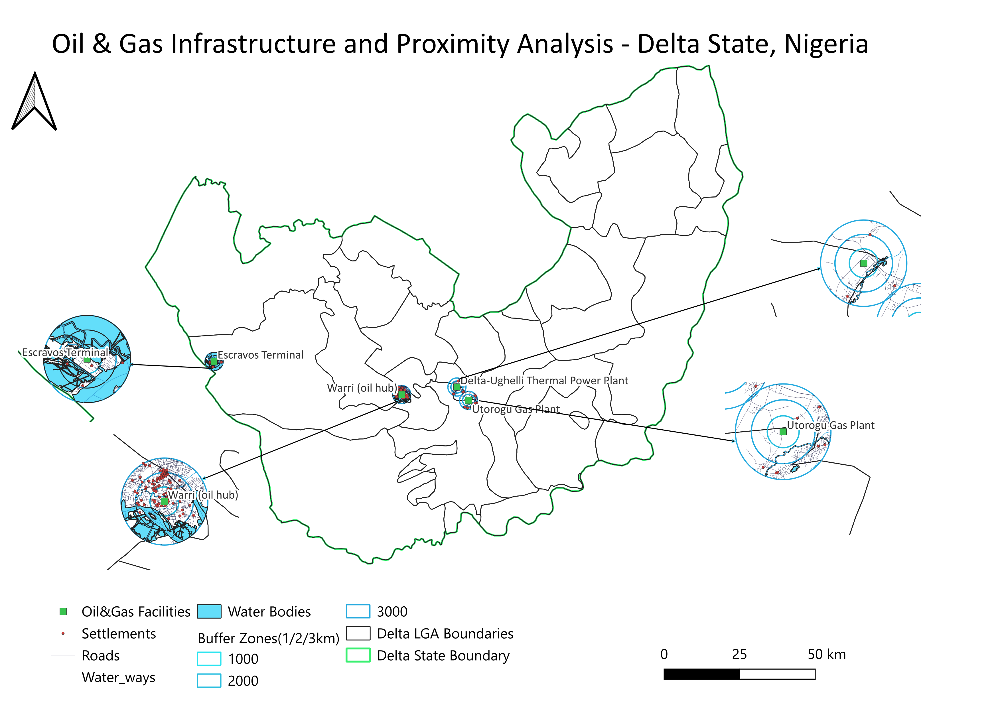

# Project 3 — Oil & Gas Infrastructure & Proximity Analysis

## Overview
A spatial analysis of oil and gas infrastructure in Delta State, Nigeria, examining the proximity of documented facilities to surrounding settlements and road networks. Graduated buffer zones were used to assess how infrastructure exposure changes with distance.

## Tools & Data
- **GIS Software:** QGIS 4.0
- **Coordinate Reference System:** EPSG:32631 — WGS 84 / UTM Zone 31N
- **Data Sources:** OpenStreetMap (OSM), GRID3, HDX/OCHA, and publicly available facility data

## Methodology
Four documented oil and gas facilities were mapped and analysed using 1 km, 2 km, and 3 km buffer zones. Settlement and road layers were intersected with the buffers to quantify nearby settlements and road networks.

Settlement results from OpenStreetMap and GRID3 were compared to assess how the choice of dataset affects the analysis.

## Key Results
- **4** oil and gas facilities mapped.
- **114** settlements identified within 3 km using GRID3.
- **214.7 km** of road network within 3 km of the facilities.
- Settlement counts increased from **31 within 1 km** to **114 within 3 km**.
- GRID3 identified approximately **four times as many settlements as OpenStreetMap**, highlighting the importance of dataset selection in rural and riverine areas.

## Limitations
The analysis covers four documented facilities and does not represent a complete inventory of Delta State's oil and gas infrastructure. Settlement figures are estimates, not census counts. One facility location was represented at town-level precision because its exact position was not publicly available.

## Map

