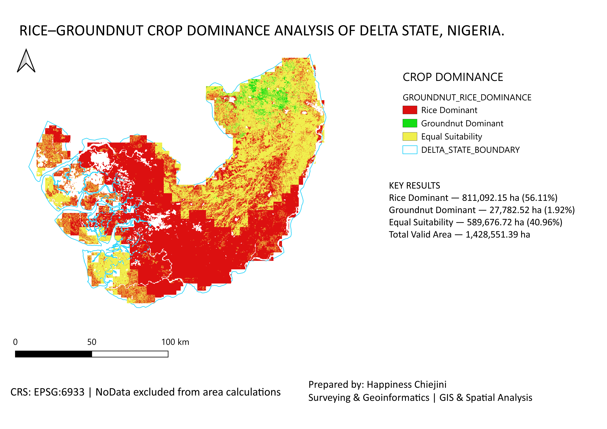

# Agricultural Land Suitability Analysis

## Project Overview

A GIS-based assessment of land suitability for rice and groundnut production in Delta State, Nigeria. The analysis integrated climatic, soil, terrain, and land-use factors to identify areas with greater suitability for each crop.

## Tools & Data

* **Software:** QGIS
* **Rainfall:** CHIRPS
* **Temperature:** WorldClim
* **Soil:** SoilGrids
* **Terrain:** SRTM DEM and slope
* **Land Cover:** Land Use/Land Cover (LULC)

## Methodology

The datasets were processed, reclassified, weighted, and combined using a multi-criteria weighted overlay approach to produce the final crop suitability map.

## Key Results

The analysis identified the following crop dominance patterns:

| Classification     |  Area (ha) | Percentage |
| ------------------ | ---------: | ---------: |
| Rice-dominant      | 811,092.15 |     56.11% |
| Groundnut-dominant |  27,782.52 |      1.92% |
| Equal suitability  | 589,676.72 |     40.96% |

*These results represent the modelled suitability classifications.*

## Final Map

## Project Details

* **Study Area:** Delta State, Nigeria
* **Field:** GIS and Spatial Analysis
* **Application:** Agricultural Land Suitability Assessment
